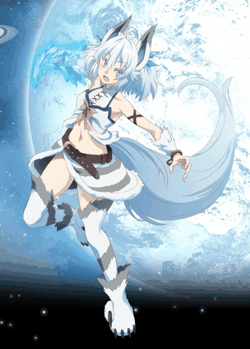

# 赛博刹那 CYBERMOT

<samp>REVERSE ENGINEERING · CS2 ZE MAPPING · ANIMATION</samp>

  

  

<i>THE MOMENT IS INFINITE.</i>

## 你好，我是刹那 HELLO, WORLD

一个喜欢把游戏拆开、看看里面藏了什么的**动画人**，也是 **CS2 Zombie Escape 地图作者**。
白天在 Unity 包里翻模型，晚上在 Source 2 里摆地图，偶尔把过程写进[博客](https://cybermot.bomber.asia/)。

> 独立于世界，也连接着世界。

- 🔭 维护 **[BomberStudio](https://github.com/Hoshino486/BomberStudio)** —— 面向 Windows 的 Unity 资源浏览 / 预览 / 导出工具，支持 UnityCN 与多种游戏容器
- 🗺️ 给 CS2 做 ZE 地图，也给跑图服写 **[ZePractice](https://github.com/Hoshino486/ZePractice)** 插件
- 🎨 解包 / 绑骨 / 皮肤 / 动画，偶尔在 B 站发点模型鉴赏
- 🌐 更多文章与日常都在 **[cybermot.bomber.asia](https://cybermot.bomber.asia/)**

## 在做的东西 PROJECTS

| 项目 | 是什么 | 技术 |
| :--- | :--- | :--- |
| **[BomberStudio](https://github.com/Hoshino486/BomberStudio)** | Unity 游戏资源浏览、预览与导出，支持 UnityCN 和多种游戏容器 | `C#` · `.NET` |
| **[BomberStudio Blender Bridge](https://github.com/Hoshino486/BomberStudio_Blender)** | 把导出的模型、材质、图集接进 Blender，整理后导出 FBX | `Python` · `Blender` |
| **[ZePractice](https://github.com/Hoshino486/ZePractice)** | CS2 ZE 跑图服插件：练习模式、指挥系统、换图投票、工坊更新、诊断 HUD | `C#` · `CounterStrikeSharp` |
| **[cybermot-site](https://github.com/Hoshino486/cybermot-site)** | 个人博客：文章、项目、照片墙、音乐与碎碎念 | `TypeScript` |
| **[CS2-Character-skin-file](https://github.com/Hoshino486/CS2-Character-skin-file)** | CS2 角色皮肤文件，用来做地图皮肤 | `Source 2` |
| **[Unpackaging-tools](https://github.com/Hoshino486/Unpackaging-tools)** | 解包工具与关键文件的备份 | `Tooling` |

## 博客里还有什么 ELSEWHERE

- [照片墙](https://cybermot.bomber.asia/photowall) —— 用画面留住时间
- [音乐](https://cybermot.bomber.asia/music) —— 给生活一点背景音乐
- [说说](https://cybermot.bomber.asia/moments) —— 一些没头没尾的碎碎念
- [灵境](https://cybermot.bomber.asia/tree) —— 在交互里发现好奇
- [友链](https://cybermot.bomber.asia/friends) —— 去朋友家坐坐

## 工具箱 TOOLBOX

## 找到我 CONTACT

- **Blog** · [cybermot.bomber.asia](https://cybermot.bomber.asia/)
- **Bilibili** · [@赛博刹那_](https://space.bilibili.com/1818296505)
- **Steam** · [赛博刹那](https://steamcommunity.com/profiles/76561199543091926/)
- **Email** · [3418449640@qq.com](mailto:3418449640@qq.com)

  记录刹那，连接无限。 · 2026 — ∞

